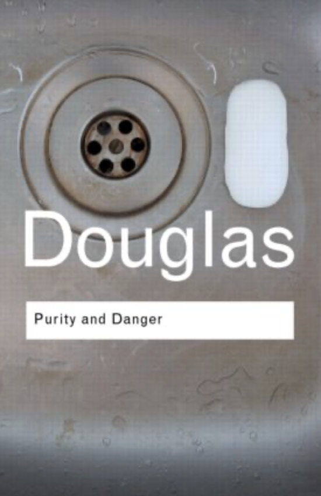

### Policjant własnego umysłu. O regulacji emocji, moralności i kulturze czystości psychicznej

---

# Pytanie na początek

Czy są emocje, których człowiek NIE POWINIEN odczuwać?

---

# Ale co właściwie oceniamy?

* Emocję?
* Myśl o emocji?
* Impuls do działania?
* Działanie?
* Konsekwencje działania

---

# Przykład

* Ktoś cię publicznie upokarza.
* Pojawia się: „Mam ochotę go uderzyć.”

Czy:

**A.** zrobiłem coś złego?

**B.** pomyślałem coś złego?

**C.** poczułem coś złego?

**D.** nic jeszcze nie zrobiłem?

---

# Dzisiaj będziemy mieszać trzy porządki

* Psychologia -> Co robią emocje?
* ACT -> Co jeśli problemem nie jest sama emocja, ale walka z nią?
* Filozofia/kultura -> Skąd wiemy, że pewnych stanów psychicznych „nie powinno być”?

---

# CZĘŚĆ I

# Czym właściwie jest regulacja emocji?

---

# Regulacja emocji ≠ „uspokajanie się”

Regulacja może wpływać na:

- **jakie** emocje pojawiają się
- **kiedy** się pojawiają
- **jak długo** trwają
- **jak intensywne** są
- **jak je interpretujemy**
- **jak je wyrażamy**

---

# Czy dobra regulacja oznacza...

* ...że rzadko czuję negatywne emocje?
* Niekoniecznie 

---

Można czuć dużo i regulować dobrze

Można też:

* prawie niczego nie czuć na zewnątrz
* bardzo dużo robić, żeby nie czuć

---

# Emocja jako informacja?

Emocje mogą:

- kierować uwagę
- przygotowywać do działania
- wspierać uczenie się
- pomagać oceniać znaczenie sytuacji
- wpływać na relacje społeczne

Ale:

**emocja nie jest automatycznie prawdą o świecie.**

---

# Złość

* Może sygnalizować: „Przekroczono moją granicę.”

* Ale nie dowodzi, że: „Moja interpretacja sytuacji jest prawdziwa.”

* I tym bardziej nie dowodzi, że: „Powinienem zaatakować.”

---

# Lęk

* Może sygnalizować: „Może istnieć zagrożenie.”
* Ale:

**Lęk ≠ Dowód zagrożenia**

---

# Zazdrość

* Może mówić: „Ta relacja jest dla mnie ważna.”
* Ale:

**Zazdrość ≠ Dowód zdrady**

---

Emocja może być:

* **funkcjonalna** bez bycia trafną
* **trafna** bez oznaczania obowiązku działania

---

# CZĘŚĆ II

# Czy można kontrolować emocje?

---

# Doświadczenie

* Przez 30 sekund nie myślcie o egzaminie z Emocji i Motywacji 
* A teraz spróbujcie przez 30 sekund **nie czuć złości**
* Żeby sprawdzić, czy nadal czuję złość muszę **monitorować** czy nadal ją czuję
* Paradoks: próba pozbycia się doświadczenia może wymagać **ciągłego skupiania uwagi na doświadczeniu**
* Jak byście to połączyli z wiedzą o regulacji emocji?

---

# ACT - Acceptance and Commitment Therapy

* Jeden z nurtów 3 fali CBT (Terapii Poznawczo-Behawioralnej)
* **Celem nie musi być usunięcie nieprzyjemnych doświadczeń.**
* **Czy potrafię działać w zgodzie z tym, co jest dla mnie ważne, kiedy nieprzyjemne doświadczenie jest obecne?**

---

# Elastyczność psychologiczna

* Zamiast dążenia do "usuwania" przykrych emocji i doświadczeń...
* ...umiejętność działania w zgodzie ze swoimi wartościami nawet wtedy, kiedy umysł i ciało produkują trudne doświadczenia

* Akceptacja nie oznacza aprobaty
* Można akceptować swoją złość bez mówienia "akceptuję, że powinienem kogoś skrzywdzić"

---

# CZĘŚĆ III

# A może problemem nie jest emocja...?

---

* Czujesz zazdrość 
* Myślisz "nie powinienem być zazdrosny..."
* "To źle, że jestem zazdrosny"
* "Co to mówi o mnie?"
* "Nie powinienem taki być, zazdrość krzywdzi innych"
* Nagle nie czujesz tylko zazdrości, ale też poczucie winy, wstyd, lęk, samotność...

---

# Wszyscy snujemy historie o sobie samych

* Pierwotne doświadczenie - "czuję zazdrość"
* Ocena - "nie powinienem być zazdrosny"
* Historia - "skoro jestem zazdrosny, jestem złym człowiekiem"

---

# Czy jest sens oceniać emocje w kategoriach moralności?

* Czy zazdrość jest zła?
* Czy złość jest zła?
* Czy nienawiść jest zła?
* Czy pożądanie jest złe?
* Czy radość z cudzego nieszczęścia jest zła?

---

# Moralność wymaga rozróżnień

Możemy oceniać:

* Pojawienie się emocji
* Interpretację tej emocji
* Intencję/zamiary
* Wybory/decyzje
* Działania pod wpływem emocji
* Konsekwencje działań lub emocji

---

# Przykład

* „Czuję ogromną zazdrość wobec przyjaciela.” -  czy zrobiłem coś moralnie złego?
* "Czuję zazdrość więc postanawiam sprawić, żeby jego projekt się nie udał" - czy coś się zmieniło?
* "Czuję zazdrość więc celowo rozpowszechniam fałszywą informację, żeby go zdyskredytować" - a teraz?

---

# To samo źródło "negatywnej" emocji może prowadzić do:

* niczego
* refleksji
* rozmowy
* rywalizacji
* manipulacji
* krzywdy
* itp.

---

# Emocja nie jest instrukcją obsługi

**„Czuję X”**

nie znaczy

**„Zrób Y”**

---

# Z drugiej strony: czy kontrola emocji zawsze jest problemem?

- Przed egzaminem czujesz silny lęk, ale skupiasz się na zadaniu.
- W pracy czujesz złość, ale odkładasz reakcję do czasu spokojnej rozmowy.
- W sytuacji zagrożenia ignorujesz panikę, żeby pomóc drugiej osobie.

Czy w tych sytuacjach kontrola emocji jest czymś niepożądanym?

---

# Argumenty za kontrolą emocji

Kontrola może pomagać:

- odraczać impulsywne reakcje
- realizować długoterminowe cele
- chronić relacje i współpracę
- działać mimo silnego pobudzenia
- dostosowywać zachowanie do sytuacji społecznej

Czy bez pewnej kontroli emocji życie społeczne byłoby możliwe?

---

# Argumenty przeciw nadmiernej kontroli

Kontrola może też:

- wymagać dużego wysiłku poznawczego
- odwracać uwagę od zadania
- utrudniać rozpoznawanie własnych potrzeb
- zwiększać poczucie winy lub nasilenie emocji, gdy ona nie znika
- prowadzić do unikania sytuacji wywołujących trudne emocje

Kiedy kontrola pomaga, a kiedy zaczyna kosztować zbyt wiele?

---

# Czy istnieje jedna najlepsza strategia?

Tłumienie, reinterpretacja, akceptacja i zmiana sytuacji mogą prowadzić do różnych skutków.

Znaczenie mają m.in.:

- kontekst
- cel
- intensywność emocji
- dostępne zasoby
- krótko- i długoterminowe konsekwencje

Może ważniejsza od kontroli lub akceptacji jest elastyczność w wyborze strategii?

---

# CZĘŚĆ IV

# Myśli, których "nie powinno być"

---

# „Brudny” umysł

Mówimy:

- „mam brudne myśli”
- „to obrzydliwa myśl”
- „nie powinienem o tym myśleć”
- „normalny człowiek by tak nie pomyślał”
- „co ze mną nie tak?”

---

* Czy pojawienie się myśli jest zachowaniem?
* Czy pojawienie się myśli samo w sobie jest złe?

---

Myśl ≠ Intencja

Myśl ≠ Pragnienie

Myśl ≠ Plan

Myśl ≠ Działanie

Myśl ≠ Tożsamość

---

# Defuzja poznawcza (ACT)

* Zamiast: „Jestem beznadziejny.”
* Spróbuj: „Mam myśl, że jestem beznadziejny.”
* „Zauważam, że pojawia się myśl, że jestem beznadziejny.”
* Co się zmieniło?

---

# CZĘŚĆ V

# Nieczystość

---

# Mary Douglas - "Purity and Danger"



---

* „Brud” można rozumieć jako coś, co znajduje się „nie na swoim miejscu”
* Naruszenie kategorii i porządku
* Koncepty czystości i brudu są też systemami tworzonymi przez społeczeństwa, by uporządkować chaos

---

# Czyste/nieczyste

* ciało  
* seksualność  
* jedzenie  
* choroba  
* śmierć  
* wydzieliny

ale także:

* myśli, pragnienia, emocje, intencje

---

> **Czy współczesne normy dotyczące „dobrego życia” tworzą również normy dotyczące tego, jakie stany psychiczne uznajemy za akceptowalne?**

---

Czy dobry człowiek:

- powinien być empatyczny?
- powinien kontrolować złość?
- powinien nie zazdrościć?
- powinien mieć „zdrowe” granice?
- powinien lubić siebie?
- powinien umieć regulować emocje?
- powinien być odporny psychicznie?

---

# Nowa norma?

* Nie tylko: **„Powinieneś dobrze się zachowywać.”**
* Również: **„Powinieneś dobrze zarządzać swoim wnętrzem.”**

---

# CZĘŚĆ VI

# Panoptikon

---

# Panoptikon - Jeremy Bentham 

* Więzień nie wie, kiedy jest obserwowany.
* Dlatego może zacząć **obserwować sam siebie**


---

# Michel Foucault - panoptikon jako metafora

* Zewnętrzna kontrola może zostać uwewnętrzniona
* Nie trzeba cały czas mówić człowiekowi, co ma robić, jeśli sam będzie się pilnował
* Czy jestem wystarczająco spokojny?
* Czy jestem wystarczająco empatyczna?
* Czy naprawdę ją kocham?

Warto uważać, żeby samoobserwacja nie zamieniła się w samonadzór

---

# ALE: Czy normy emocjonalne zawsze nas ograniczają?

Normy mogą mówić:

- nie upokarzaj innych, kiedy jesteś zły
- nie traktuj zazdrości jako dowodu zdrady
- nie działaj na podstawie chwilowego impulsu
- spróbuj zrozumieć perspektywę drugiej osoby

Czy są to wyłącznie narzędzia kontroli społecznej?

Może nie chodzi o rezygnację z norm, tylko o świadome i odpowiednie do sytuacji stosowanie się do nich?

---

# Argument: normy mogą chronić innych

Normy dotyczące zachowania mogą:

- ograniczać przemoc
- ułatwiać współpracę
- chronić osoby bardziej narażone na krzywdę
- wspierać przewidywalność relacji
- pomagać rozwiązywać konflikty

**Czy odrzucenie norm emocjonalnych zawsze zwiększa wolność?**

---

# Argument: normy mogą też szkodzić

Normy mogą również:

- zawstydzać za zwyczajne reakcje
- utrwalać nierówności
- wymagać od niektórych osób większej samokontroli niż od innych
- delegitymizować uzasadniony gniew
- mylić spokój z dojrzałością

**Kto ustala, jaka emocja jest „stosowna” — i kto ponosi koszty tej normy?**

---

# CZĘŚĆ VII

# Czy współczesna kultura prowadzi do nadmiernej samokontroli emocjonalnej?

---

# Hipoteza

Możliwe, że współczesna kultura zwiększa:

- samoobserwację
- zarządzanie wizerunkiem
- język samodoskonalenia
- monitorowanie dobrostanu
- presję „pracy nad sobą”

---

Ale współczesna kultura może również:

- zwiększać język akceptacji
- normalizować rozmowy o emocjach
- zwiększać dostęp do pomocy psychologicznej
- osłabiać niektóre tabu
- pozwalać na większą różnorodność doświadczeń

Jakie nowe formy samonadzoru pojawiają się wraz z nowymi formami wolności?

---

# Przykład

* Dawniej często słyszano "nie wolno ci być smutnym, inni mają gorzej"
* Dzisiaj częsciej słyszymy "powinieneś umieć regulować swój smutek" - co jest prawdą!
* Ale obie normy **mogą** prowadzić do wniosku, że smutek jest problemem, który należy rozwiązać

---

* Kultura dobrostanu może pomagać ludziom, ale w skrajnej interpretacji może prowadzić do tworzenia nowych ograniczeń 
* Zdrowie psychiczne może stawać się kolejnym ideałem, do którego należy dążyć (obsesja?)

---

# CZĘŚĆ VIII

# Wróćmy do emocji

---

# Czy istnieją „złe” emocje?

TAK - w pewnym sensie...

Niektóre reakcje emocjonalne mogą być:

- nieadekwatne
- nadmierne
- szkodliwe
- oparte na błędnych interpretacjach
- kosztowne społecznie

---

NIE — jeśli przez „złe” rozumiemy „moralnie winne tylko dlatego, że się pojawiły”.

Emocja może być problematyczna bez bycia "niemoralną"

To samo dotyczy myśli

---

# Podsumowanie - czy wolno ci czuć to, co czujesz?

* Psychologicznie - emocje i myśli często pojawiają się bez bezpośredniej, świadomej decyzji
* Moralnie - sama obecność doświadczenia nie jest tym samym co działanie
* Funkcjonalnie - nie każda emocja jest trafna lub pomocna
* ACT - nie musisz najpierw pozbywać się trudnego doświadczenia, żeby działać zgodnie ze swoimi wartościami


```